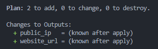
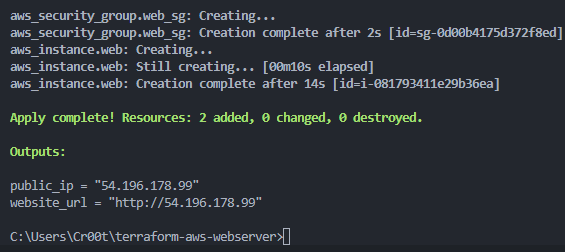
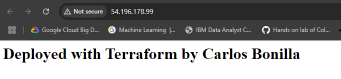
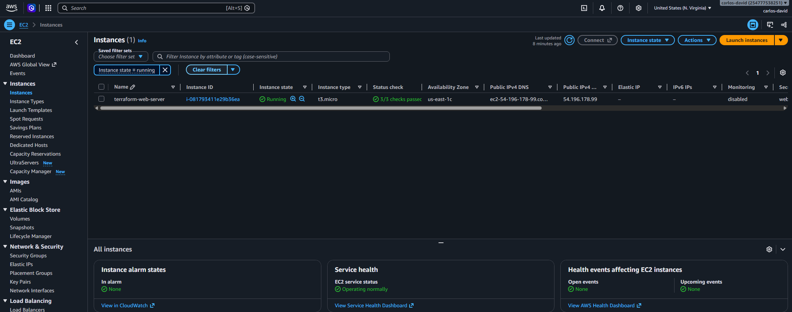

# Terraform AWS Web Server

Provisions an Apache web server on AWS EC2 using Terraform. This is a hands-on Infrastructure as Code (IaC) project covering the full Terraform lifecycle: `init` → `plan` → `apply` → `destroy`.

## Architecture

```
Terraform (local)
   │
   ▼
AWS Provider (us-east-1)
   ├── Data source: latest Amazon Linux 2023 AMI (read only)
   ├── Security Group (web-sg): allows inbound HTTP on port 80
   └── EC2 Instance (t3.micro)
          └── user_data script installs and starts Apache
                 └── Serves a web page at http://<public_ip>
```

```
Internet ──(port 80)──▶ Security Group ──▶ EC2 Instance ──▶ Apache ──▶ index.html
```

## Tech Used

- **Terraform**: Infrastructure as Code
- **AWS**: EC2, Security Groups, IAM, AMI data source
- **Bash**: bootstrap script via `user_data`
- **Git / GitHub**: version control

## Project Structure

| File | Purpose |
|---|---|
| `main.tf` | Provider config, AMI lookup, security group, and EC2 instance |
| `variables.tf` | Configurable inputs (region, instance type) |
| `outputs.tf` | Prints the public IP and website URL after deployment |
| `.gitignore` | Keeps state files, provider plugins, and secrets out of Git |
| `.terraform.lock.hcl` | Pins the AWS provider version for consistent runs |

## How to Run

**Prerequisites:** Terraform, and the AWS CLI configured with an IAM user (`aws configure`).

```bash
terraform init       # Download the AWS provider
terraform fmt        # Format the code
terraform validate   # Check the syntax
terraform plan       # Preview changes
terraform apply      # Create the infrastructure
terraform destroy    # Tear everything down
```

## Screenshots

### Plan: previewing 2 resources to create


### Apply: infrastructure created


### Live website


### EC2 instance running in the AWS console


### Destroy: clean teardown


---

# Refresher Notes

## The Big Idea

**The `.tf` files describe what you *want*. The state file records what Terraform has *actually built*.**

Terraform's whole job is to close the gap between the two: `plan` compares intent (code) against reality (state + AWS), and `apply` makes reality match, then updates the state.

## Key Concepts

### Infrastructure as Code (IaC)
Defining infrastructure in code files instead of clicking around a console. The benefits: it's **repeatable** (same code, same result), **version-controlled** (every change tracked in Git), **reviewable** (plan before apply), and **disposable** (destroy and rebuild anytime).

### Declarative vs. imperative
Terraform is **declarative**: you describe the end state ("one server with port 80 open"), and Terraform figures out the steps. Imperative tools (scripts) require you to write each step yourself.

### Core building blocks

| Term | What it is | In this project |
|---|---|---|
| **Provider** | Plugin that lets Terraform talk to a platform's API | `hashicorp/aws` (downloaded by `terraform init`) |
| **Resource** | Something Terraform **creates and manages** | Security group, EC2 instance |
| **Data source** | Something Terraform only **reads** (already exists) | Latest Amazon Linux AMI lookup |
| **Variable** | An input value, so nothing is hardcoded | `region`, `instance_type` |
| **Output** | A value printed after apply | `public_ip`, `website_url` |
| **State** | Terraform's record of what it built | `terraform.tfstate` |
| **Lock file** | Pins the exact provider version | `.terraform.lock.hcl` |

### State file essentials
- Maps code names (`aws_instance.web`) to real AWS IDs (`i-0817...`).
- **You write the `.tf` files. Terraform writes the state file.**
- **Never edit it by hand, delete it, or push it to GitHub** (it can contain secrets).
- If it's lost, Terraform "forgets" your resources, and they keep running and costing money.
- **Teams use remote state** (HCP Terraform or S3) for shared access, **state locking** (no two applies at once), version history, and encryption.

### Idempotency
Running `terraform apply` again with no code changes does **nothing** ("No changes"). Terraform only acts on differences, so it's always safe to re-run.

### Drift
If someone changes a resource manually in the AWS console, reality no longer matches the code. That's called **drift**. The next `terraform plan` detects it and proposes changes to bring the resource back in line with the code.

### Dependency graph
Terraform works out the order automatically from references. The instance references `aws_security_group.web_sg.id`, so the security group was created first, and on destroy it was deleted last.

### Provisioning vs. configuration
- **Provisioning** = creating infrastructure (servers, networks, firewalls). This is Terraform's job.
- **Configuration** = setting up software *on* a server. Here, a `user_data` script handled it. At scale, teams use tools like Ansible, or **Packer** (HashiCorp) to build pre-configured machine images.

## What Was Built

**1. Security group (`web_sg`)**: a virtual firewall.
- Inbound: HTTP on port 80 from anywhere (`0.0.0.0/0` = all IP addresses)
- Outbound: all traffic (so the server could download Apache)
- Everything else inbound is blocked, including SSH (port 22)

**2. EC2 instance (`web`)**: the virtual server.
- `t3.micro` (2 vCPUs, 1 GB of RAM), running Amazon Linux 2023
- Attached to the security group above

**Not created:** the AMI lookup is a data source, which is why the plan said **2 to add**, not 3.

### How the web page got there (`user_data`)
`user_data` is a script AWS runs automatically on the server's **first boot**:

| Line | What it does |
|---|---|
| `#!/bin/bash` | Run as a Bash (Linux) script |
| `dnf install -y httpd` | Install Apache (`dnf` = Amazon Linux's installer; `-y` = auto-yes) |
| `echo "<h1>...</h1>" > /var/www/html/index.html` | Write the web page into Apache's default folder |
| `systemctl enable --now httpd` | Start Apache now and on every reboot |

**Apache (`httpd`)** is web server software. It listens on port 80, and when a browser requests the page, it sends back `index.html`. Its main alternative is Nginx.

## Making Changes

Terraform reads **every `.tf` file in the folder** as one configuration. The file names are a convention for humans, not something Terraform cares about. It does not read subfolders, `README.md`, or non-`.tf` files.

### Workflow
1. Edit the relevant `.tf` file(s) and **save**
2. `terraform fmt` and `terraform validate`
3. `terraform plan`: review exactly what will change
4. `terraform apply`: make the change
5. `git add .` → `git commit -m "describe change"` → `git push`

### Which file to edit

| Goal | Edit | Example |
|---|---|---|
| Add, remove, or change a resource | `main.tf` | Open port 443, add an S3 bucket |
| Change a setting's value | `variables.tf` (the `default`) | `t3.micro` → `t3.small` |
| Make a hardcoded value configurable | `variables.tf` (new variable) + `main.tf` (`var.name`) | Turn the web page message into a variable |
| See new info after deploy | `outputs.tf` | Output the instance ID or public DNS |
| Change the provider or its version | `main.tf` (`terraform {}` block), then `terraform init` | Upgrade the AWS provider |

### Overriding values without editing code
Create a `terraform.tfvars` file (loaded automatically):

```hcl
instance_type = "t3.small"
```

This allows the same code to run with different values per environment (e.g., small in dev, large in prod). `*.tfvars` is in `.gitignore`, since these files often hold environment-specific or sensitive values.

### Reading the plan

| Symbol | Meaning |
|---|---|
| `+` | Create |
| `~` | Update in place |
| `-` | Destroy |
| `-/+` | Replace (destroy, then recreate) |

Some changes force a replacement. For example, changing `user_data` or the AMI recreates the instance and assigns a **new public IP**. Always review the plan before applying.

### Rebuilding from scratch
After a `destroy`, run `terraform apply` again to rebuild. From a new machine:

```bash
git clone https://github.com/carlosdbonilla/terraform-aws-webserver.git
cd terraform-aws-webserver
terraform init
terraform apply
```

## Command Cheat Sheet

| Command | What it does |
|---|---|
| `terraform init` | Download providers and set up the folder (run first, and after provider changes) |
| `terraform fmt` | Auto-format code |
| `terraform validate` | Check syntax |
| `terraform plan` | Preview changes (changes nothing) |
| `terraform plan -out=tfplan` | Save the plan so `apply` runs exactly what was reviewed |
| `terraform apply` | Make the changes |
| `terraform destroy` | Delete everything Terraform manages |
| `terraform output` | Re-display outputs (e.g., the IP) |
| `terraform state list` | List resources in the state |
| `terraform show` | Readable view of the current state |
| `terraform plan \| findstr /C:"will be" /C:"Plan:"` | Windows: show only the plan summary lines |
| `aws configure` | Set the AWS access keys and default region for the CLI |
| `aws sts get-caller-identity` | Confirm which AWS user the CLI is using |

## Glossary

| Term | Meaning |
|---|---|
| **EC2** | Elastic Compute Cloud, AWS's virtual servers |
| **AMI** | Amazon Machine Image, the OS template a server boots from |
| **Region** | A geographic AWS location (`us-east-1` = N. Virginia). The console only shows resources in the selected region. |
| **IAM** | Identity and Access Management, which controls who can do what in AWS |
| **IAM user vs. root** | Root = account owner with unlimited power (never use its access keys). Terraform runs as `terraform-user` with EC2-only permissions (**least privilege**). |
| **Access keys** | Credentials the CLI/Terraform use, set up with `aws configure`. Never put them in code. |
| **Security group** | A virtual firewall controlling inbound and outbound traffic |
| **Port** | A numbered "door" on a server. 80 = HTTP, 443 = HTTPS, 22 = SSH. |
| **CIDR** | IP range notation. `0.0.0.0/0` = every IP address. |
| **Public IP** | The internet-facing address AWS assigns. It changes each time the instance is recreated. |
| **HCP Terraform** | HashiCorp's managed platform (formerly Terraform Cloud): remote state, locking, a plan review UI, and drift detection |

## Git Notes

- **`origin`** = nickname for the GitHub repo URL. **`main`** = the branch name. `git push -u origin main` sends `main` to `origin`, and `-u` remembers the pairing, so afterward a plain `git push` works.
- **`.gitignore`** keeps files out of Git. In VS Code, ignored files appear **greyed out** (`.terraform/`, `terraform.tfstate`).
- **The `.terraform/` folder** holds the downloaded AWS provider plugin. It's not committed, since `terraform init` re-downloads it.
- **Commit `.terraform.lock.hcl`**, so everyone uses the same provider version.
- **Always check `git status`** before committing to confirm no state files or secrets are staged.
- In Windows `cmd`, `<` and `>` are special characters, so placeholders like `<your-username>` must be replaced, not typed.

## Gotchas I Hit

- **Folders instead of files:** in the VS Code Explorer, a `>` arrow means a folder. Use the New File icon.
- **Unsaved files:** a white dot on a tab means unsaved, and Terraform reads only what's saved to disk ("No changes" was the symptom). Turn on **File → Auto Save**.
- **Root access keys:** AWS warns against them, so create an IAM user instead.
- **Instance "missing" in the console:** check the region selector (top right).
- **Site won't load:** use `http://` (not `https://`), and wait 1–2 minutes after apply for Apache to install.
- **Cost:** always run `terraform destroy` when done.

## What I Learned

- Declarative infrastructure: describe the end state and let Terraform plan the steps
- Plan before apply: preview every change before anything is touched
- The dependency graph orders resource creation automatically
- State is how Terraform tracks reality, and why teams need remote state
- Data sources look up existing values (like the latest AMI) instead of hardcoding them
- Least privilege: Terraform runs as a dedicated IAM user, never root
- Cost control: `terraform destroy` removes everything cleanly

## Next Steps

- Move state to **HCP Terraform** for remote state, locking, and a visual plan review
- Refactor into reusable **modules**
- Build a custom **VPC** and subnets instead of using the default VPC
- Add **HTTPS** with a load balancer and certificate
